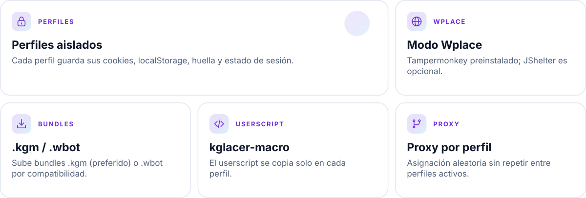
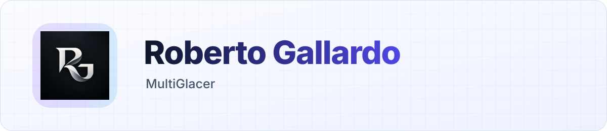

<a id="top"></a>

<h1 align="center">MultiGlacer</h1>

<p align="center">Organiza perfiles de navegador independientes desde un panel. Prepara el entorno, crea un perfil y ábrelo cuando lo necesites.</p>

Plataforma para manejar múltiples perfiles persistentes de navegador con Camoufox + Next.js + Python.

<!-- kit:nav -->
<p align="center"><a href="#instalación-paso-a-paso-local"><picture><source media="(prefers-color-scheme: dark)" srcset="assets/readme-builder/kit/nav-es-01-dark.svg" /></picture></a>&nbsp;
<a href="#docker"><picture><source media="(prefers-color-scheme: dark)" srcset="assets/readme-builder/kit/nav-es-02-dark.svg" /></picture></a>&nbsp;
<a href="#crear-perfiles-paso-a-paso"><picture><source media="(prefers-color-scheme: dark)" srcset="assets/readme-builder/kit/nav-es-03-dark.svg" /></picture></a>&nbsp;
<a href="README.en.md"><picture><source media="(prefers-color-scheme: dark)" srcset="assets/readme-builder/kit/nav-es-04-dark.svg" /></picture></a></p>
<!-- /kit:nav -->

## Qué hace

<!-- kit:features -->
<p align="center"><picture><source media="(prefers-color-scheme: dark)" srcset="assets/readme-builder/kit/features-es-dark.svg" /></picture></p>
<!-- /kit:features -->

<p align="center"><picture><source media="(prefers-color-scheme: dark)" srcset="assets/readme/diagrams/profiles-es-dark.svg" /></picture></p>

<p align="center"></p>


## Requisitos

- **Node.js 20+**
- **Python 3.10+**
- Sistema con escritorio gráfico si vas a abrir Camoufox en modo visible.
- Descarga Python: https://www.python.org/downloads/
- Descarga Node.js: https://nodejs.org/en/download
<p align="center"></p>


## Instalación paso a paso (local)

1. Instala dependencias de Node:

```bash
npm install
```

2. Inicia la app:

```bash
npm run dev
```

3. Abre la UI:

- `http://localhost:6969`

4. En la UI, haz click en **Prepare environment** para instalar entorno Python/Camoufox.
   - Equivale a:

```bash
python -m pip install --upgrade pip
python -m pip install -r python/requirements.txt
python -m camoufox fetch
```

### Scripts de preparación (1 click)

- Windows: `prepare-environment.bat`
- macOS/Linux: `./prepare-environment.command`

Estos scripts:
- validan Python/Node y muestran versiones,
- instalan dependencias con `pnpm` (si existe) o `npm`,
- instalan `python/requirements.txt`,
- ejecutan `python -m camoufox fetch`.
<p align="center"></p>


## Docker

```bash
docker compose up --build
```
<p align="center"></p>


## Crear perfiles paso a paso

### Perfil normal

1. Click en **New profile**.
2. Completa nombre, icono, URL y sistema operativo.
3. (Opcional) Activa/desactiva proxy.
4. Click en **Save**.

### Perfil Wplace

1. Click en **New profile**.
2. Activa **Wplace mode**.
3. Pega tokens (uno por línea o separados por coma).
4. (Opcional) Elige **Reference profile**.
5. Selecciona OS y proxy.
6. Click en **Save**.

> Importante: ya no deberías tener que maximizar manualmente Camoufox para que el flujo continúe. El runner intenta traer ventana al frente y maximizarla automáticamente.
<p align="center"></p>


## Notas de preparación Wplace

- Por defecto, la creación de perfiles responde rápido y **no bloquea** esperando preparación pesada de navegador.
- Si necesitas forzar preparación al crear, puedes usar:

```bash
WPLACE_PREPARE_ON_CREATE=1 npm run dev
```
<p align="center"></p>


## Scripts de arranque rápido

- Linux npm: `./start-npm.sh` (o `./start.sh`)
- Linux pnpm: `./start-pnpm.sh`
- macOS: `./start.command`
- Windows npm: `start-npm.bat` (o `start.bat`)
- Windows pnpm: `start-pnpm.bat`
- Inicio automático (elige pnpm/npm): `start.bat` (Windows) y `./start.command` (macOS/Linux)
<p align="center"></p>


## Troubleshooting

- Si no abre instancias: ejecuta **Prepare environment** y valida Python 3.10+.
- Si falla userscript: valida conectividad a la URL raw del script.
- Si migras script y quieres reinstalar: elimina `profiles/<id>/.wplace_userscript_installed_beta`.
- Si usas Linux sin `DISPLAY`, el runner puede cambiar a modo virtual/headless.
<p align="center"></p>


## Arquitectura

- UI: `app/`
- API server: `app/api/*`
- Lógica server: `src/server/*`
- Runner Python Camoufox: `python/run_one.py`
- Persistencia: `data/app.db`, `data/settings.enc.json`, `profiles/<id>/`
<p align="center"></p>


## Branding

© 2026 King Gallardo

<p align="center"><a href="#top"><picture><source media="(prefers-color-scheme: dark)" srcset="assets/readme-builder/kit/btn-volver-al-inicio-outline-sm-dark.svg" /></picture></a></p>

<!-- readme-builder:signature:start -->
<p align="center"><a href="https://github.com/robgallardof"><picture><source media="(prefers-color-scheme: dark)" srcset="assets/readme/brand/signature-es-dark.svg" /></picture></a></p>
<!-- readme-builder:signature:end -->
